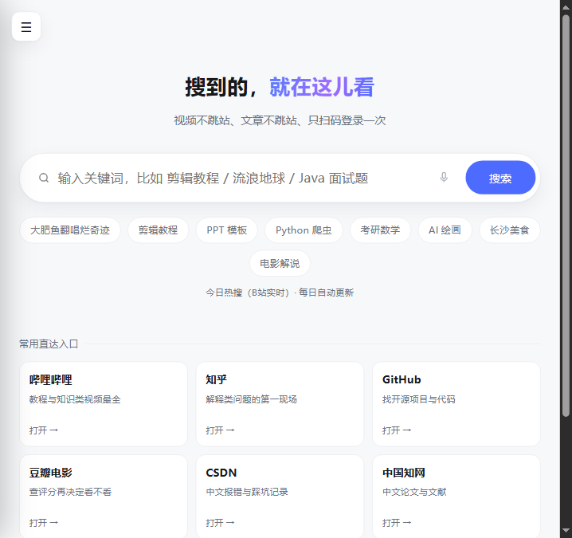

# 纯净搜索 · 站内观看版

一个在本机跑的小搜索站：界面在自己的页面里，搜什么就在这儿看什么，不跳出去、不注册一堆账号、结果里没有推广位。

### 长什么样

首页：搜索框、热词推荐、今日热搜、常用直达入口。



搜「剪辑教程」的结果页：B站视频封面、UP 名、播放量全都在，点开就在本页播。


### 快速开始

```bash
git clone https://github.com/liminlan/PureSearch.git
cd PureSearch
python server.py
```

依赖只有标准库（网页抓取、视频解析、代理、正文提取全部手写），**不需要 pip install 任何东西**。
想用语音搜索再装 `faster-whisper`（可选，不装就自动隐藏麦克风）。启动后浏览器访问 `http://127.0.0.1:8766/`。
Windows 用户直接双击 `start.bat` 也行。

## 一、它到底做了什么

- **搜索聚合**：一次关键词，同时拉网页（Bing）、视频（B站）、影视条目（豆瓣）三类结果，合并成一页。
  网页源里带广告标记的块会被跳过，只留自然结果。
- **视频站内播放**：B站结果点开就在当前页面播放，走本机代理解析出的直链，**不跳 bilibili.com**，进度条可拖动。
  视频流由 `/api/stream` 代理，支持 Range 请求（206），支持 m3u8 分片与加密密钥的 URL 改写。
- **文章站内阅读**：网页结果旁边有「站内阅读」按钮，抓正文、洗掉广告和无关模块，在站内排版显示，图片也走代理不裂。
- **领域网站推荐**：搜不同话题时右侧栏给出该领域公认好用的站点（哔哩哔哩 / 知乎 / 豆瓣 / 少数派 / 什么值得买 等），点一下直达。
- **只登录一次**：B站扫码登录（右上角/侧栏入口），授权一次，之后本机保存，不用反复登。

## 二、文件说明

| 文件 | 作用 |
| --- | --- |
| `start.bat` | 双击启动。自动找端口、开浏览器 |
| `server.py` | 后端全部逻辑：聚合、B站解析与播放、正文抓取、代理、登录、采集源 |
| `article.py` | 正文提取与清洗（去广告块、保留图片） |
| `sites.json` | 各领域推荐站点库，可自己加 |
| `sources.json` | 你添加的采集源，默认空 |
| `static/index.html` | 前端单页：搜索页 / 播放器 / 阅读器 / 源管理 / 主题 |
| `static/hls.min.js` | m3u8 播放支持（hls.js） |
| `static/qrcode.min.js` | 扫码登录二维码 |

运行时还会生成：`wbi.json`（B站接口密钥缓存）、`buvid.json`（匿名设备指纹缓存）、`auth.json`（登录后凭据）、`run.log`（启动日志）。

## 三、怎么用

1. 双击 `start.bat`，浏览器自动打开 `http://127.0.0.1:8766/`。
2. 输入关键词回车。默认综合页，可切「视频 / 网页 / 影视 / 网站」。
3. 视频卡片点封面即在本页播放；网页条目点「站内阅读」看正文。
4. 想登录 B站获取更高清晰度：侧栏「登录 B站（扫码一次）」，用手机 B站 App 扫一下。

也可以直接用链接参数跳转（方便存书签）：
- `?q=关键词` 直接搜
- `?play=BV号` 直接开播放器
- `?read=网址` 直接开阅读器
- `?src=1` 打开采集源管理
- `?login=1` 打开扫码窗
- `?theme=dark` 暗色主题

## 四、怎么加采集源（看剧用）

站内看剧依赖第三方 CMS 采集接口（AppleCMS 协议），程序只提供**机制**，不预置任何源。

- 打开侧栏「采集源管理」→ 填 `https://xxx.com/api.php/provide/vod` 这类地址 → 保存。
- 或者「粘贴订阅链接」导入一份 JSON 源列表（LibreTV 那种格式：数组或 `{"sources":[...]}`，每条含 `api` 或 `url` 字段），一次最多导入 30 条，导入后仍要点「保存」。
- 保存后重新搜索，命中的片子会出现在「视频」里，点开即播（m3u8 自动经本地代理改写）。

注意：源的稳定性、画质、是否有版权授权，都由你自己选择和负责。

## 五、已知限制（都是真实存在的）

- **网页结果每页 10 条**：Bing 无会话翻页参数无效，翻不动，这是源本身的限制。
- **B站接口有风控**：偶发 HTTP 412 或返回空，程序会自动补 `buvid` 指纹并退回到不带签名的老接口重试；极端情况仍可能这一轮没视频。
- **CSDN / 掘金抓不到正文**：站点反爬（521 / 404），这类条目只能「原站打开」。
- **GitHub 仓库源已从聚合里移除**：接口在国内常 20 秒以上，会把整页拖死。
- **采集源画质多为 720P**，且源站会失效，需要自己换源。
- **扫码登录踩的是非官方协议路径**，有小概率被风控；失败就隔一会儿再扫。
- **文章站内全文属于转载展示**，仅供自己阅读，不要公开分发。

## 六、说明

本站不存储、不转码、不托管任何视频文件，播放与阅读都发生在你本机浏览器里，内容来自你配置的第三方接口或公开网络。用来做什么、访问哪些源，由使用者自行判断并承担相应责任。

## 七、这版新增的优化

**速度与稳定性**
- 每个数据源有自己的等待上限（网页 4s / 视频 4.5s / 影视 2.5s / 采集源 5s），超时源直接放弃，不再拖住整页返回；结果页会显示「分源」耗时。
- 缓存分级：视频 15 分钟、网页 5 分钟、影视 30 分钟、采集源 10 分钟；空结果只短存 60 秒，避免一次风控把某个关键词的结果钉死半小时。
- 缓存表加了过期清理与容量上限，长时间跑不会越堆越大。
- 搜索失败时播放器给「重试一次」按钮，并区分「解析失败 / 源已失效 / 直链取不到」等具体原因，不再一片空白。

**交互**
- 输入框带历史词联想（历史搜索 + 常搜词）。
- 没手动选分类时，按意图自动切到最贴的标签页（搜教程自动进「视频」、搜片名自动进「影视」、搜技术词自动进「代码」），有结果才跳。
- 搜索过程中显示骨架屏与「正在并行搜索」，慢源失败不会让页面看起来像卡死。

**站内阅读更诚实**
- CSDN、掘金、知乎、小红书、抖音、百度、公众号这些抓不到干净正文的站，结果里直接标「该站不支持站内阅读」，只留「原站打开」，不再让你等十几秒后拿到一句失败。

**推荐站点更好用**
- 右侧「这类内容去哪找最好」每张卡两个入口：**搜「关键词」→**（带当前词进入该站搜索结果）、**去首页**。

**采集源可体检**
- 源管理里新增「检测全部」：并发给每个源打一次最小搜索请求，标出「可用 / 慢 / 失效」并显示耗时，失效源一眼可见。

## 八、第二轮：热搜 / 联想 / 每日自动更新

**首页快捷词（chips）**
- 修复了点不动的问题：之前全局点击只认侧栏词条，认不出首页 chips；现在统一按 `data-q` 属性识别，点任意词条直接开搜。

**输入联想浮层**
- 输入框聚焦或打字时，从「历史搜索 + 今日热搜」里筛出候选，每条右侧标「历史」或「热搜」，鼠标点一下即搜。
- 历史记录会自动清理「只差一个错字」的重复项（编辑距离 ≤1 视为同一个词），不会再堆一长串近似的脏记录。

**今日热搜（每日自动更新）**
- 后端新增 `GET /api/hot`，读取同目录下 `hot.json`；文件超过 48 小时未更新会在数据里标 `stale`，前端可以提示。
- `update_daily.py` 负责抓一次热词：取 B 站热搜榜 → 只保留命中兴趣领域（剪辑 / 考研 / 游戏 / 美食 / 摄影 / 编程 / AI 等）且长度 ≤8 字的短词 → 不足 8 个用内置常用词补齐 → 写回 `hot.json`。全程白名单策略，不做黑名单过滤。
- 运行方式两种：
  1. 双击 `update_hot.bat`（手动更新一次）；
  2. 挂 Windows 计划任务，每天定时跑：
     ```
     schtasks /create /tn "PureSearch-hot" /tr "python \"<项目目录>\update_daily.py\"" /sc daily /st 07:30
     ```
     删除：`schtasks /delete /tn "PureSearch-hot" /f`
- 更新 `hot.json` 后**不需要重启服务**，刷新网页即可看到新词（服务每次请求现读文件）。

**当前 hot.json 内容示例**
```
大肥鱼翻唱烂奇迹 / 剪辑教程 / PPT 模板 / Python 爬虫 / 考研数学
AI 绘画 / 长沙美食 / 电影解说 / 手机摄影
```

## 九、第三轮：加载更多 / 语音 / 收藏 / 官网下载直达

**加载更多（能翻就多翻点）**
- 视频：B 站接口按页翻，最多 6 页（约 120 条），每点一次追加 20 条，自动去重。
- 网页：必应按页翻，最多 4 页（约 40 条），每点一次追加 10 条。
- 翻到头以后按钮消失，替换成一句「这一类已经翻到头了」，底部始终保留两个直达链接：**B站全部结果** / **必应更多页**（`GET /api/more?q=&type=video|web&page=N`）。
- 页面上会实时显示「已加载：视频 N 条 · 网页 N 条」。

**语音输入（本地识别，不走云端）**
- 搜索框右侧有麦克风图标，点一下开始录音（最多 15 秒），再点一下结束并识别，结果直接填进搜索框并自动搜索。
- 识别引擎是本机的 **faster-whisper small（int8 CPU）**，模型放在 `models/`，首次下载完就不再联网；语音数据只发到本机 `127.0.0.1`，不上传任何服务器。
- 首次识别要加载模型，约 5–15 秒；之后每次 1–3 秒（实测 1.8 秒音频 = 5.6 秒，含冷启动）。
- 后端接口：`POST /api/asr`（JSON `{"audio":"data:audio/wav;base64,..."}`），返回 `{ok,text,sec}`；`GET /api/asr/status` 可查是否可用。
- 依赖：`pip install faster-whisper zhconv`（zhconv 只用于把繁体结果转简体）。

**收藏**
- 视频卡、网页卡右上角 ★ 点一下就收藏，再点取消。
- 侧栏「我的收藏」显示数量与最近 5 条；点「★ 收藏夹」打开完整列表，可「站内播放 / 站内阅读 / 打开 / 删除」。
- 收藏存在浏览器本地存储（`ps_fav`），换浏览器或清缓存会丢。

**官网下载直达**
- 内置 32 个常用软件的「官网下载页」映射（`software.json`，全部为官方域名，2026-11-20 逐个实测可访问）。
- 搜「剪映安装包」「vscode 下载」这类词，结果最上方直接给一张「官网直达」卡，按钮直达官方下载页，不经过任何第三方下载站。
- 匹配用词边界，避免「digital」误命中「git」这类问题；没命中就不出现，不会干扰普通搜索。

---

## 十、第四轮：低成本打磨（A 组）

> 体检后从 A/B/C 三档里先只做 A 档「低成本打磨」，不动架构、不加外部依赖。

**1. 结果排序与筛选（视频区）**
- 视频区顶部多了一排胶囊按钮：`按播放量` `最新发布` `10 分钟内` `30 分钟内` `近半年`，右侧实时显示「筛后 N / 共 M 条」。
- 再点一次同一个按钮即取消该项条件；`清空条件` 一键复原。
- 后端 `bili_search` 结果里补了 `pubdate` 字段（发布时间戳），「近半年」和「最新发布」才有依据；播放量由 `play` 的「万/亿」换算成数字比较。
- 筛选发生在已拉到的当前页内，不额外请求接口，所以是 0 延迟。

**2. 播放进度记忆 + 继续看**
- 播视频时每 5 秒记一次进度到 `ps_prog`（浏览器本地存储），最多保留 20 条。
- 侧栏新增「继续看」：显示最近 5 条，带一条进度条和 `当前/总时长`，点一下直接接着播。
- 下次从同一集打开会自动跳到上次位置；看完（进度 >95%）或才看 3 秒以内的记录会被自动清掉，不留垃圾。
- 站点内 `?play=BV号` 直接打开也会读进度。

**3. 弹窗关闭方式**
- 五个弹窗（播放器 / 阅读器 / 登录 / 源管理 / 收藏夹）统一支持 `ESC` 直接关，以及点遮罩空白处关闭。
- 关播放器时会同时清掉播放器内容与剧集列表，不会残留上一集的画面。

**4. 搜索失败可重试**
- 请求出错时不再是干巴巴一行红字，而是给一个「重试一次」按钮，点击用同一个关键词和当前 tab 重新请求。

**5. 窄屏复查（≤480px）**
- 新增 `@media(max-width:480px)`：视频卡最小宽度降到 146px 保证两列并排、筛选胶囊缩小一档、结果区左右留白收窄、首页大标题降字号。
- 窄屏下侧栏仍是抽屉（☰ 打开、点遮罩收起），登录 / 收藏 / 源管理入口不会消失。
- 顺带清掉了 CSS 里重复定义的一处 `.sideBack`。

---

## 十一、第五轮：手感打磨（顺滑细节）

**搜索入口**
- 首页打开自动聚焦搜索框；`Ctrl+K` 随时聚焦，`/` 也能（正在输入时不抢）。
- 空关键词回车不再静默：输入框提示「请先输入要搜的内容」并自动聚焦，2 秒后恢复原文案。
- 联想浮层支持 `↑ ↓` 上下选（选中的直接写进输入框），`Enter` 搜它、`Esc` 收起。

**位置与滚动**
- 新搜索、切换 tab 都自动回到顶部（实测从 900px 滚回 0），不会再“翻完停在中段”。

**历史**
- 侧栏历史每条 hover 出现 `×`，可单条删除（只删这一条，其余保留），不必再用「清空」全抹掉。

**播放**
- 播放器改为「静音自动播」：打开即出声前的 muted 自动播放绕过浏览器拦截，用户点一下播放器任意位置恢复音量。实测同一个视频从「停 0:00 黑屏」变成 `readyState=4`、正常计时播放。

**窄屏**
- 修复 860px 以下结果页顶部搜索条被左上角 ☰ 菜单按钮压住的问题（`.topbar` 增左内边距），实测搜索框起点从被遮挡变为 99px 起。

---

## 十二、图标与桌面部署

**图标**
- 新图标：放大镜 + 播放三角，蓝紫渐变、圆角方（squircle）底座、四角透明，去掉了底板上的雾状光晕。
- `static/` 内已生成全套：`icon.png`（1536 原始）、`icon-tight.png`（裁掉透明外边）、`icon-1024/512/256/128/64/48/32/16.png`、`icon.ico`（256/128/64/48/32/16 多尺寸）。
- 页面内：侧栏品牌位换成 `icon-128.png`（原「纯」字方块移除），浏览器标签页 favicon 用 `icon-256.png`。

**桌面三种形态**
1. `桌面\纯净搜索\` —— 源码目录（含 `models\` 语音模型），`start.bat` 仍在。
2. `桌面\纯净搜索（本机版）.lnk` —— 指向系统 Python 3.12 的 `pythonw.exe` 跑 `server.py`，无黑窗、**含语音识别**（已在 Python312 里装好 faster-whisper + zhconv，模型复用目录内的 `models\`）。
3. `桌面\纯净搜索.exe` —— PyInstaller 单文件版（约 25MB），双击即跑，不依赖 Python，可发给别人。

**exe 的实现要点**
- 打包命令：`python -m PyInstaller --onefile --windowed --name PureSearch --icon static\icon.ico --add-data "static;static" --add-data "sites.json;." --add-data "software.json;." --add-data "hot.json;." server.py`，并排除 `faster_whisper/ctranslate2/torch/transformers/tokenizers/onnxruntime/av/scipy/pandas`。
- `server.py` 已支持 `sys.frozen`：只读资源（static / sites.json / software.json / hot.json）从 `_MEIPASS` 取，可写数据（auth.json / sources.json / wbi.json / buvid.json / hot.json / models）落在 exe 同目录；首次运行会把种子 `hot.json` 复制过去。
- exe 版**不含语音模型**：`asr_available()` 在无 `models\` 目录时直接返回 False，不会偷偷下载 460MB，麦克风按钮会提示不可用。
- 启动诊断日志写到系统临时目录 `%TEMP%\puresearch_start.log`（不污染桌面）。

**已知差异**
- exe 版首次双击要解包，启动约 3–8 秒；Python 版启动约 1 秒。
- exe 版是 windowed 无控制台，关闭需在任务管理器结束 `PureSearch.exe`（或直接关机）；Python 版同一进程名 `pythonw.exe`。
- 两个版本都默认抢 8766，被占用时按 8766→8765→8767→8770→8899 顺延，可同时开。
